<!------------------------------------------------ Intro Card ------------------------------------------------>
<!-- 

  <a href="https://www.linkedin.com/in/jessicaslusark/">
  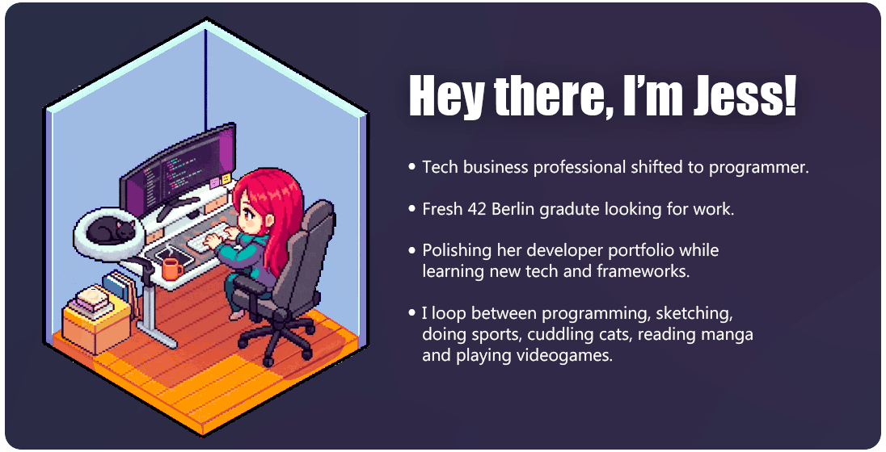
  </a>

 
-->
<!------------------------------------ Header ----------------------------->
<!-- Cards are generated by scripts/render_cards.py -->

  <picture><source media="(prefers-color-scheme: dark)" srcset="cards/dark/hero.svg" /></picture>

  <a href="#full-stack"><picture><source media="(prefers-color-scheme: dark)" srcset="cards/dark/tile-full-stack.svg" /></picture></a>
  <a href="#backend"><picture><source media="(prefers-color-scheme: dark)" srcset="cards/dark/tile-backend.svg" /></picture></a>
  <a href="#game-dev"><picture><source media="(prefers-color-scheme: dark)" srcset="cards/dark/tile-game-dev.svg" /></picture></a>

<!------------------------------------ About and Experience ----------------------------->

I am a `Software Engineer` with a background in `B2B consulting and technical operations` in the mobile apps and games industry.
My experience across established enterprise software companies often required my direct involvement in `stakeholder communication` and `product strategy`, gaining unique skills in `problem-solving`, `analytical thinking` and `cross-team collaboration`.

I'm a naturally curious person who's always been driven by the `'what-if'` and `'why-not'` while focusing on the `how` and `why` of things, which is a mindset I naturally carry over to both my work and personal life.

I have a passion for building `full-stack` applications across web and mobile. I prioritize `modular architecture`, `abstract design`, and `iterative testing` to turn complex problems into clean, scalable, and highly maintainable code.

I also have a special interest in `game programming`, in which I apply my recent game development experience I acquired at <a href="https://www.linkedin.com/company/ubisoft/"> Ubisoft</a> and combine it with my industry expertise from my past work at <a href="https://www.linkedin.com/company/unity/"> Unity</a>, <a href="https://www.linkedin.com/company/gameanalytics/"> GameAnalytics</a>, <a href="https://www.linkedin.com/company/playtestcloud/"> PlaytestCloud</a> and <a href="https://www.linkedin.com/company/sensor-tower/"> Sensor Tower</a>.

 

 <!----------------- Contacts ----------------->

  
  
  <!----------------- ViewCount ----------------->
  

 

<!------------------------ Featured Projects ------------------------>
<!-- <h1 align="center">Featured projects</h1> -->
<!-- # Featured projects -->

<!-- 
<i>👉 If on mobile, scroll sideways on each section to see each project</i>
 -->

<table align="center">
  <tr>
    <td colspan="4"><h3><picture><source media="(prefers-color-scheme: dark)" srcset="https://cdn.simpleicons.org/react/white" /></picture>&nbsp;Full-stack &amp; Interfaces</h3></td>
  </tr>
  <tr>
    <td width="300" valign="top"><b>WannaWatch</b> <a href="https://wannawatch.vercel.app"><b>Live demo ↗</b></a>&nbsp;&nbsp;&nbsp;<a href="https://github.com/JSlusark/wannawatch"><b>Repo ↗</b></a> <a href="https://github.com/JSlusark/wannawatch">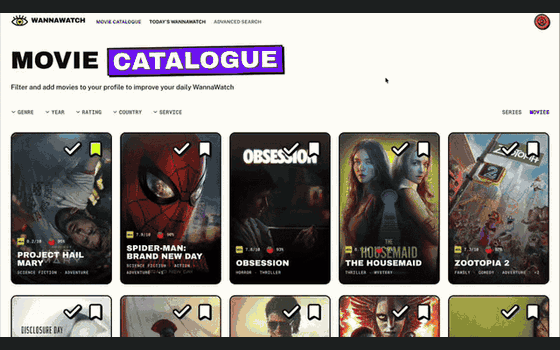</a> A full rework of the My Movie List concept: a full-stack movie app with AI-powered recommendations, a stack of daily swipeable recommendations and an evolving viewer persona.  <b>Made with:</b>        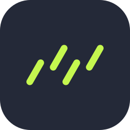     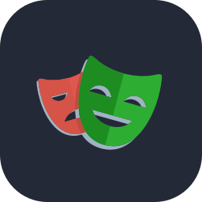 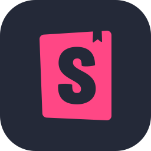  </td>
    <td width="300" valign="top"><b>Uno with Friends</b> <a href="https://github.com/JSlusark/Uno-with-friends"><b>Repo ↗</b></a> <a href="https://github.com/JSlusark/Uno-with-friends">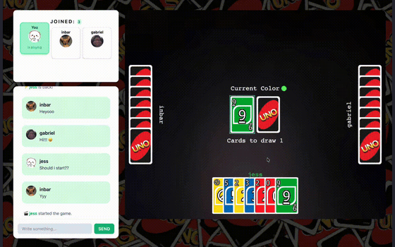</a> Online multiplayer card game built as a full-stack team project with 4 developers.  <b>Made with:</b>       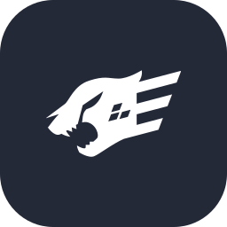 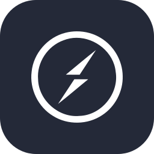      </td>
    <td width="300" valign="top"><b>My Movie List</b> <a href="https://mymovielistj.netlify.app/"><b>Live demo ↗</b></a>&nbsp;&nbsp;&nbsp;<a href="https://github.com/JSlusark/My_Movie_list"><b>Repo ↗</b></a> <a href="https://github.com/JSlusark/My_Movie_list">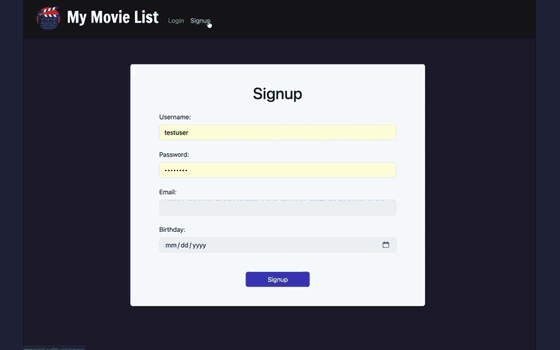</a> React frontend and Node/Express API for browsing a movie database, logging in and managing a list of favorites.  <b>Made with:</b>       </td>
    <td width="300" valign="top"><b>Trivia Data Visualizer</b> <a href="https://jslusark.github.io/trivia-data-visualizer/"><b>Live demo ↗</b></a>&nbsp;&nbsp;&nbsp;<a href="https://github.com/JSlusark/trivia-data-visualizer"><b>Repo ↗</b></a> <a href="https://github.com/JSlusark/trivia-data-visualizer">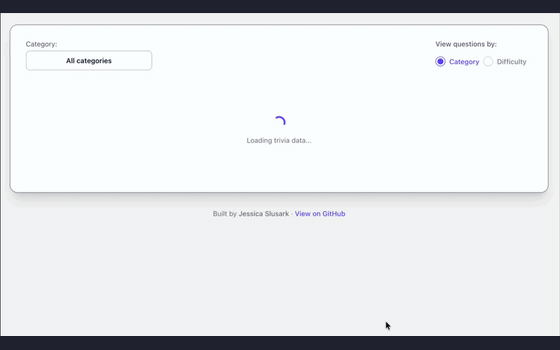</a> Interactive dashboard that turns live trivia API data into filterable charts, built with React, TypeScript and Recharts.  <b>Made with:</b>          </td>
  </tr>
</table>

<table align="center">
  <tr>
    <td colspan="4"><h3><picture><source media="(prefers-color-scheme: dark)" srcset="https://cdn.simpleicons.org/gnubash/white" /></picture>&nbsp;Backend / Systems</h3></td>
  </tr>
  <tr>
    <td width="300" valign="top"><b>My Movie List API</b> <a href="https://mymovielist-api-dhqp.onrender.com/"><b>Live API ↗</b></a>&nbsp;&nbsp;&nbsp;<a href="https://github.com/JSlusark/My_movie_list_API"><b>Repo ↗</b></a> <a href="https://github.com/JSlusark/My_movie_list_API">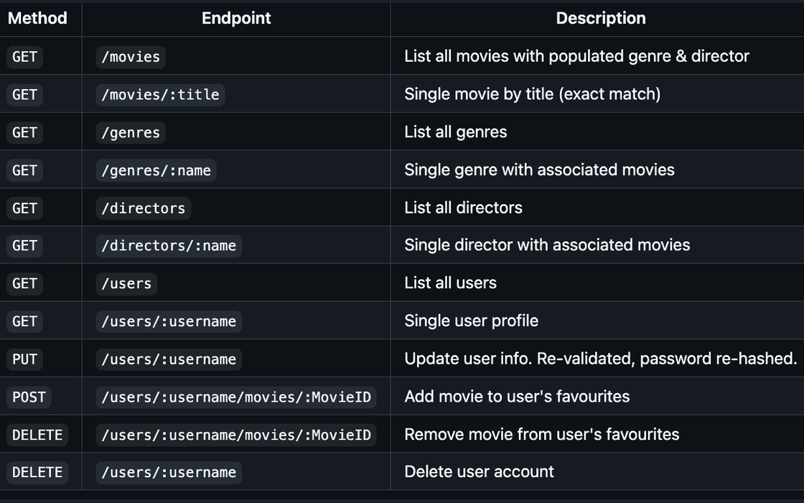</a> REST API behind My Movie List, built with Node, Express and MongoDB, with JWT auth and input validation.  <b>Made with:</b>       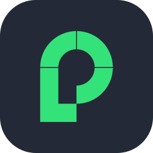  </td>
    <td width="300" valign="top"><b>Webserv</b> <a href="https://github.com/JSlusark/Webserver"><b>Repo ↗</b></a> <a href="https://github.com/JSlusark/Webserver">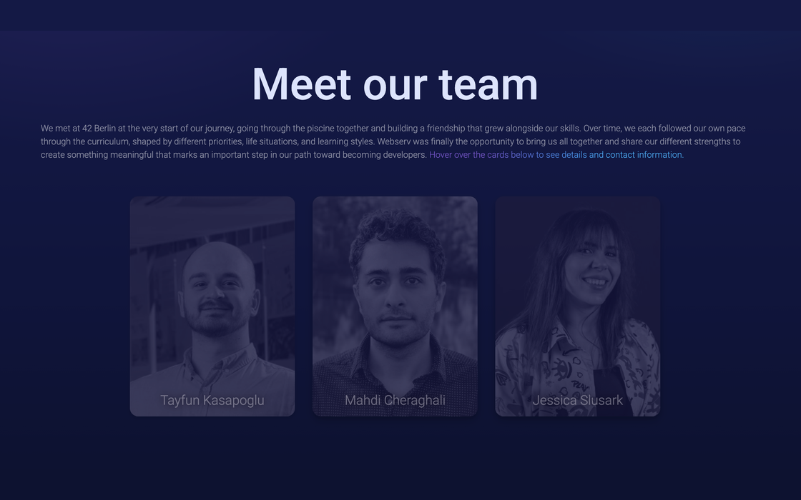</a> HTTP/1.1 web server in C++98 built as a team of 3, with non-blocking I/O, CGI and config files.  <b>Made with:</b>       </td>
    <td width="300" valign="top"><b>Minishell</b> <a href="https://github.com/JSlusark/Minishell"><b>Repo ↗</b></a> <a href="https://github.com/JSlusark/Minishell">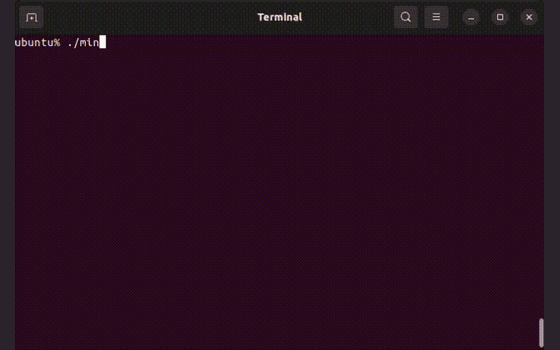</a> Bash-like shell written in C as a team, with pipes, redirections, built-ins and environment variables.  <b>Made with:</b>    </td>
    <td width="300" valign="top"><b>Bootstrapped Docker Infrastructure</b> <a href="https://github.com/JSlusark/bootstrapped-docker-infrastructure"><b>Repo ↗</b></a> <a href="https://github.com/JSlusark/bootstrapped-docker-infrastructure">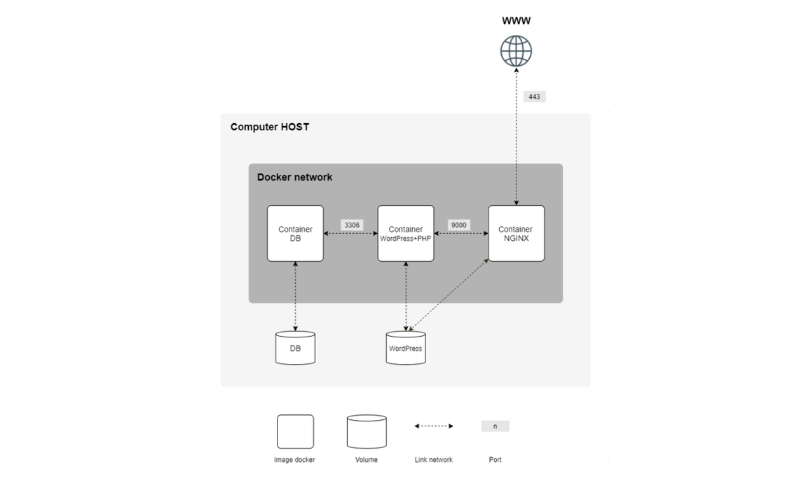</a> Multi-service Docker Compose setup with TLS, secrets management and isolated networking.  <b>Made with:</b>       </td>
  </tr>
</table>

<table align="center">
  <tr>
    <td colspan="4"><h3><picture><source media="(prefers-color-scheme: dark)" srcset="https://cdn.simpleicons.org/unity/white" /></picture>&nbsp;Game Development</h3></td>
  </tr>
  <tr>
    <td width="300" valign="top"><b>Clapperbox</b> <a href="https://github.com/JSlusark/Clapperbox"><b>Repo ↗</b></a> <a href="https://github.com/JSlusark/Clapperbox">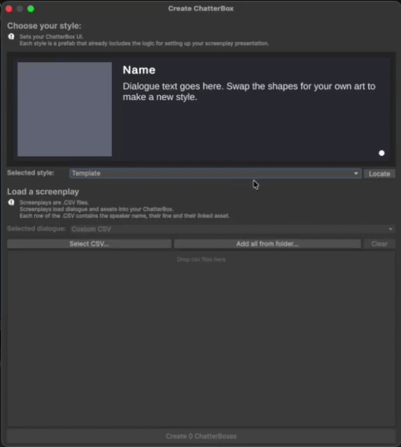</a> A Unity dialogue toolkit that automatically creates interactive screenplay boxes from a CSV.  <b>Made with:</b>  </td>
    <td width="300" valign="top"><b>Dancefluencer</b> <a href="https://github.com/JSlusark/Dancefluencer_game"><b>Repo ↗</b></a> <a href="https://github.com/JSlusark/Dancefluencer_game">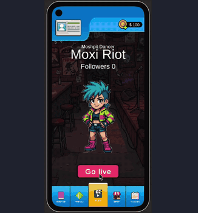</a> Hypercasual arcade/simulation mobile game prototype made in Unity during my Ubisoft mentorship.  <b>Made with:</b>   </td>
    <td width="300" valign="top"><b>Unity Toybox</b> <a href="https://play.unity.com/en/games/9056f0bf-e866-4a55-85a6-d2f5eadef156/floor-is-lava"><b>Play in browser ↗</b></a>&nbsp;&nbsp;&nbsp;<a href="https://github.com/JSlusark/Unity-Toybox"><b>Repo ↗</b></a> <a href="https://github.com/JSlusark/Unity-Toybox">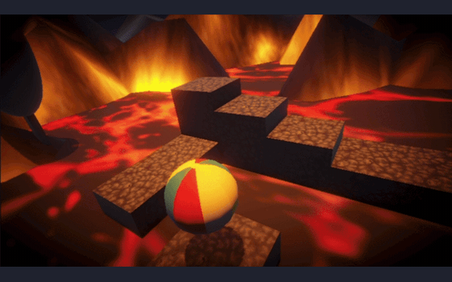</a> A collection of Unity prototypes exploring different game mechanics and ideas.  <b>Made with:</b>   </td>
    <td width="300" valign="top"><b>so_long</b> <a href="https://github.com/JSlusark/so_long"><b>Repo ↗</b></a> <a href="https://github.com/JSlusark/so_long">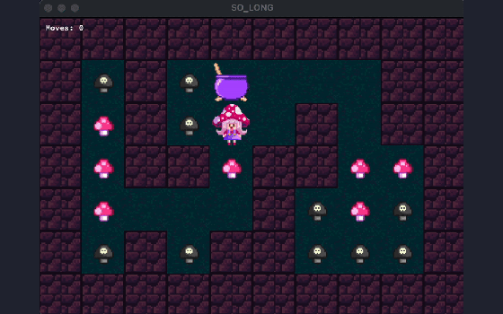</a> My own 2D game engine written in C with MiniLibX, plus a game built on it: collect every item, then reach the exit.  <b>Made with:</b>   </td>
  </tr>
</table>

 

<!--------------------- More skills & tools --------------------->
<!-- <h1 align="center">More skills &amp; tools</h1>

<b>Frontend &amp; mobile</b> <code>Angular</code> <code>Jest</code> <code>React&nbsp;Native</code> <code>Kotlin</code> <code>Expo</code> <code>Android&nbsp;Studio</code>  
<b>Backend &amp; cloud</b> <code>FastAPI</code> <code>Firebase</code> <code>AWS</code> <code>Heroku</code>  
<b>Game engines</b> <code>Godot</code>  
<b>Tools &amp; AI</b> <code>Git</code> <code>GitHub&nbsp;Copilot</code> <code>Claude</code> <code>DeepSeek</code> <code>LM&nbsp;Studio</code> <code>Llama</code> <code>MCP</code>  

  -->

 <!------------------------------------------------ Badges & Widgets ------------------------------------------------>
<!-- <h3 align="center">Badges and widgets</h3>  -->

# Badges and widgets

<!-- --- -->
